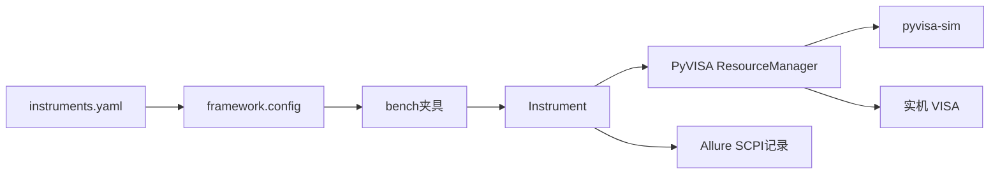

# hw-test

用 pytest 驱动仪器，用 PyVISA 收发 SCPI。资源地址放在 YAML 里，用例只通过别名拿仪器。

默认连仓库里的 pyvisa-sim 台架。克隆后不用实机，也不用 NI-VISA。

## 能做什么

- `HW_ENV` 或 `--env=sim|bench` 切换环境。没有本机 `config/instruments.yaml` 时用仓库里的示例
- 按别名打开仪器：`write` / `query` / `query_float`，以及带绝对容差的 `expect_float`
- 打开时可发 `*RST` 和 `*CLS`。结束时按配置发 `OUTP OFF`，并查询 `SYST:ERR?`，非 0 则失败
- 用例失败时把 SCPI 往来挂到 Allure
- 自带一台模拟万用表和一台模拟直流电源，`pytest` 直接跑通

## 架构



## 目录

```
framework/          配置、台架、仪器
conftest.py         pytest 夹具与失败时的 SCPI 附件
config/             instruments.example.yaml
sim/                pyvisa-sim 台架定义
examples/           万用表和电源示例
tests/unit/         不打开 VISA 的单元测试
```

## 5 分钟跑通

```bash
python3 -m venv .venv
source .venv/bin/activate
pip install -r requirements.txt
pytest
```

生成 HTML 报告需要本机已安装 [Allure 命令行](https://github.com/allure-framework/allure2)：

```bash
allure generate report/allure-results -o report/allure-report --clean
allure open report/allure-report
```

## 用例

```python
def test_measure_dc(bench):
    reading = bench["dmm"].query_float("MEAS:VOLT:DC?")
    assert abs(reading - 1.234) < 0.001
```

电源在 yaml 里标了 `output_off_on_close: true` 时，夹具结束会发 `OUTP OFF`。`check_errors: true` 时接着查询 `SYST:ERR?`。

## 换成自己的台架

1. 复制 `config/instruments.example.yaml` 为 `config/instruments.yaml`（该文件已在 `.gitignore` 中）。
2. 在 `bench` 段填写各仪器的 VISA 资源字符串。没有 NI-VISA 时再装纯 Python 后端：`pip install pyvisa-py`。
3. 让 `backend` 保持 `py`，然后 `pytest --env=bench`。环境变量 `HW_ENV` 优先于 `--env`。

```yaml
bench:
  backend: py
  timeout_ms: 5000
  instruments:
    dmm:
      resource: TCPIP0::192.168.1.10::inst0::INSTR
      read_termination: "\n"
      write_termination: "\n"
    psu:
      resource: TCPIP0::192.168.1.11::inst0::INSTR
      reset_on_open: true
      output_off_on_close: true
      check_errors: true
```

指令不要自己带结束符，结束符由 `read_termination` / `write_termination` 加上。

## 持续集成

工作流在 [`ci/hw.yml`](ci/hw.yml)。复制到 `.github/workflows/hw.yml` 后，推送到 GitHub 会执行单元测试和示例。当前账号的命令行令牌没有 `workflow` 权限时，GitHub 会拒绝直接提交 `.github/workflows` 下的文件。

## English

This is a small instrument automation framework:

1. Name each instrument in YAML and talk to it with PyVISA.
2. `pytest` uses the bundled pyvisa-sim bench, so a clone runs without hardware or NI-VISA.
3. Switch to a real bench with `HW_ENV=bench` or `--env=bench` after copying `config/instruments.yaml`.
4. On close, a supply can send `OUTP OFF` and the error queue can be checked. Failures attach the SCPI transcript to Allure.
